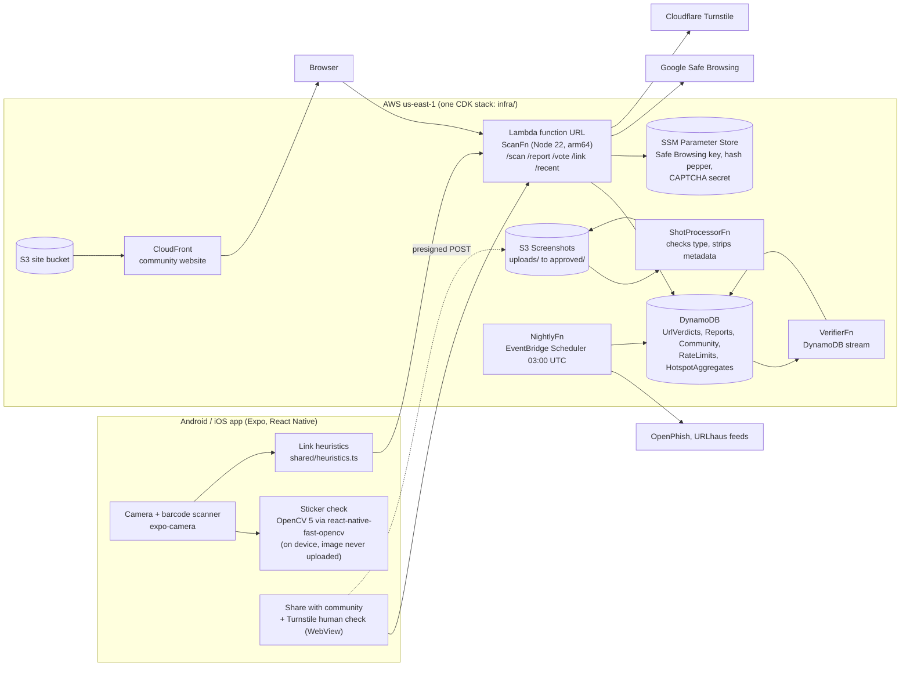

# SafeScan

SafeScan checks a QR code before you open it. Point the phone at a code and SafeScan tells you whether the link is a known threat, looks suspicious, or has been reported by other people, without visiting the link itself. On the phone, OpenCV 5 also looks for signs that a sticker has been pasted over the original QR code, a common way to swap a parking-meter or restaurant code for a phishing one.

| | |
| --- | --- |
| Community website (live) | https://dyyaknu678lsn.cloudfront.net |
| Scan API (live) | `POST https://hggnmfb55rkvypwevw5owgj3y40srnpp.lambda-url.us-east-1.on.aws/scan` |
| Technical report | [docs/TECHNICAL_REPORT.md](docs/TECHNICAL_REPORT.md) |
| Evaluation results | [docs/eval/results.md](docs/eval/results.md) |
| Sticker detector (Python, try it on your own images) | PYTHON_CODE_LINK |
| API contract | [backend/scan-lambda/API.md](backend/scan-lambda/API.md) |

Try the API without the app:

```sh
curl -X POST https://hggnmfb55rkvypwevw5owgj3y40srnpp.lambda-url.us-east-1.on.aws/scan \
  -H "Content-Type: application/json" -H "X-Install-Id: judge-test-0000000001" \
  -d '{"url":"http://testsafebrowsing.appspot.com/s/phishing.html"}'
```

## Architecture



How a scan works: the phone normalizes the link and scores it with the shared heuristics for an instant offline answer. It then sends the link to `POST /scan`. The Lambda checks the DynamoDB cache, calls Google Safe Browsing on a miss, adds feed and community signals, and returns one of four levels:

| Level | Label | Set by |
| --- | --- | --- |
| 1 | No known threats | Nothing found |
| 2 | Use caution | Heuristics, or at least 1 community report |
| 3 | Very suspicious | Community reports with at least 10 helpful votes |
| 4 | Likely malicious | Google Safe Browsing, a threat feed, or a maintainer |

Community activity alone never reaches level 4 and never changes the verdict for a popular domain.

## Repository layout

| Folder | What it is |
| --- | --- |
| `frontend/` | Expo app: scanner, results, history, share screen, OpenCV sticker check (`features/qr-tamper/`) |
| `community-site/` | Static community website (HTML, CSS, JavaScript) served from S3 through CloudFront |
| `backend/scan-lambda/` | Lambda handlers for the API, screenshot processor, verifier and nightly job |
| `shared/` | URL normalization, heuristics, verdict levels and community limits used by the app, site rules and Lambda |
| `infra/` | AWS CDK stack (`InfraStack`) that deploys everything above |
| `docs/` | Technical report, evaluation script and results, hotspot map |
| `backend/safescan-worker/` | Earlier Cloudflare Worker backend, kept as a fallback; the app no longer calls it |

## Pinned dependencies

Every Node project commits its `package-lock.json`, so `npm ci` installs the exact versions that were built and tested. Key versions:

| Component | Version |
| --- | --- |
| Node.js (local tools) | 22 LTS (Lambda runtime: `NODEJS_22_X`, arm64) |
| Expo SDK / React Native | 57 / 0.86.3 |
| OpenCV | **5.0.0** (Android, `org.opencv:opencv:5.0.0` from Maven Central) |
| react-native-fast-opencv | 1.0.1, patched to link OpenCV 5 (`frontend/patches/`, applied by `patch-package` on install) |
| react-native-webview / expo-image-manipulator | 13.16.1 / 57.0.21 |
| AWS CDK CLI / aws-cdk-lib | 2.1145.0 / 2.272.x (locked in `infra/package-lock.json`) |
| TypeScript | 7.0.x |

## Build and run

### App (Android)

The sticker check and the share screen use native modules, so the app needs a development build; Expo Go can't run them.

```sh
cd frontend
npm ci
npx eas-cli login
npx eas-cli build --profile development --platform android   # installable APK, about 15 minutes
npx expo start --dev-client                                   # then open the installed app and scan the QR code
```

To build on a connected device instead of in the cloud: `npx expo run:android`. The app calls the live API by default; set `EXPO_PUBLIC_SCAN_URL` and `EXPO_PUBLIC_COMMUNITY_URL` in `frontend/.env` to point it elsewhere (see `frontend/.env.example`).

### Community website

```sh
npx serve -s community-site -l 8080   # http://localhost:8080; -s serves index.html for /link/... like CloudFront
```

Set the Turnstile site key (public) in `community-site/config.js`. The API accepts browser calls only from the CloudFront site and `http://localhost:8080`.

## Deploy

### Backend and infrastructure

Needs an AWS account and the AWS CLI signed in to `us-east-1`.

1. Create the SecureString parameters by hand (CloudFormation can't create them):
   ```sh
   aws ssm put-parameter --type SecureString --name /safescan/safe-browsing-key --value <Google Safe Browsing API key>
   aws ssm put-parameter --type SecureString --name /safescan/hash-pepper       --value <long random string>
   aws ssm put-parameter --type SecureString --name /safescan/captcha-secret    --value <Turnstile secret key>
   aws ssm put-parameter --type SecureString --name /safescan/github-token      --value <token, only for map publishing>
   ```
2. Deploy the stack:
   ```sh
   cd backend/scan-lambda && npm ci && cd ../../infra && npm ci
   npx cdk bootstrap        # first time per account and region
   npx cdk deploy           # add -c corsOrigins=http://localhost:8080 for local website testing
   ```
   The outputs include `ScanUrl` (the API) and `SiteUrl` (the website).

### Community website

```sh
aws s3 sync community-site s3://<CommunitySite bucket> --delete --exclude README.md
aws cloudfront create-invalidation --distribution-id <distribution id> --paths "/*"
```

For the deployed stack these are `infrastack-communitysitec4341af2-9nvynpxxogvh` and `E3VOJI7SJATCWJ`.

## Test

| What | Command | Notes |
| --- | --- | --- |
| Live scan evaluation | `node docs/eval/evaluate-scan.mjs` | Labelled links against the live API; writes `docs/eval/results.md` |
| App type-check and lint | `cd frontend && npx tsc --noEmit && npx expo lint` | |
| App bundles for Android | `cd frontend && npx expo export --platform android` | |
| Backend type-check | `cd backend/scan-lambda && npx tsc --noEmit` | |
| Infrastructure tests | `cd infra && npm test` | Jest tests on the synthesized stack |
| Maintainer review | `cd backend/scan-lambda && node scripts/review.mts` | Approve screenshots, hide reports |

Manual checks on a phone (two devices for votes): scanning link A then B then nothing shows only the current code's result and disables Verify; Google's test phishing page shows Likely malicious; airplane mode shows a limited result; a report from the app appears on the link's web page; 10 helpful votes raise a link to Very suspicious, but not for a popular domain; submitted text containing `<script>` shows as plain text.

## License

See [LICENSE](LICENSE).
